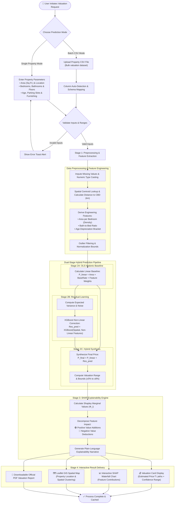
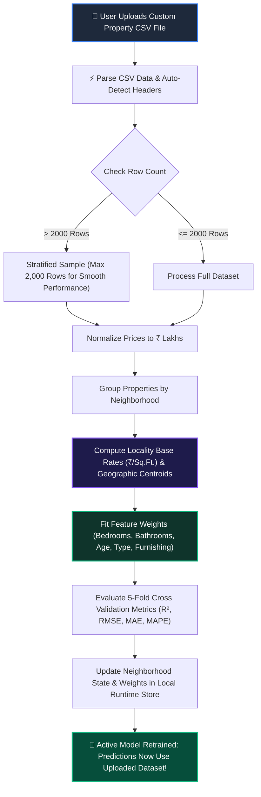

# 🏡 EstateSense AI — Explainable Hybrid House Price Prediction System

> **A dual-stage machine learning framework combining Ordinary Least Squares (OLS) Hedonic regression with Extreme Gradient Boosting (XGBoost) residual correction, local SHAP (Shapley Additive Explanations) interpretability, and interactive GIS spatial analysis.**

[](https://react.dev/)
[](https://vitejs.dev/)
[](https://tailwindcss.com/)
[](https://leafletjs.com/)
[](#-explainable-ai-shap-framework)
[](LICENSE)

---

## 📌 Table of Contents

- [Overview](#-overview)
- [System Architecture View](#-system-architecture-view)
- [Project Workflow — Kaise Chalta Hai (Flow Diagram)](#-project-workflow--kaise-chalta-hai-flow-diagram)
- [Hybrid Model Pipeline & Mathematical Architecture](#-hybrid-model-pipeline--mathematical-architecture)
- [Dynamic Model Training Flow (Custom CSV Upload)](#-dynamic-model-training-flow-custom-csv-upload)
- [Runtime Sequence Diagram](#-runtime-sequence-diagram)
- [Key Features](#-key-features)
- [Model Performance Benchmark](#-model-performance-benchmark)
- [Project Directory Structure](#-project-directory-structure)
- [Getting Started & Installation](#-getting-started--installation)
- [System Requirements & Scripts](#-system-requirements--scripts)

---

## 🔍 Overview

Traditional house price valuation models typically face a strict trade-off: **interpretable linear models (OLS)** fail to capture complex spatial and structural non-linearities, while **complex black-box models (Neural Networks, Ensembles)** lack the transparency required for real-estate lending, taxation, and buyer confidence.

**EstateSense AI** solves this dilemma through a **Dual-Stage Hybrid Architecture**:
1. **Stage 1 (Hedonic Baseline Regression):** Captures macroeconomic, fundamental pricing rules based on square footage and location-specific base rates.
2. **Stage 2 (XGBoost Residual Learner):** Trains on the residual error of the first stage, capturing non-linear feature interactions, spatial micro-patterns, and amenity premiums.
3. **Stage 3 (SHAP Explainability Engine):** Mathematically breaks down the final valuation into exact feature-by-feature positive and negative monetary contributions (₹ Lakhs).
4. **Stage 4 (Spatial GIS & Gravity Mapping):** Dynamically plots properties and calculates radial distance boundaries from central commercial hubs (e.g. Bengaluru CBD / MG Road).

---

## 🏗️ System Architecture View

The following diagram illustrates the high-level architecture of the EstateSense AI platform, detailing the boundaries between presentation, application logic, machine learning pipelines, and storage.

```mermaid
flowchart TB
    %% Styling
    classDef client fill:#1e293b,stroke:#3b82f6,stroke-width:2px,color:#f8fafc;
    classDef service fill:#1e1b4b,stroke:#8b5cf6,stroke-width:2px,color:#f8fafc;
    classDef mlEngine fill:#0f342b,stroke:#10b981,stroke-width:2px,color:#f8fafc;
    classDef dataStore fill:#312e81,stroke:#f59e0b,stroke-width:2px,color:#f8fafc;

    subgraph ClientLayer["🖥️ Frontend Presentation Layer (React 19 + Tailwind CSS)"]
        UI_Home["Home & System Overview"]:::client
        UI_Dash["Executive Performance Dashboard"]:::client
        UI_Predict["Valuation Engine & Batch CSV Processor"]:::client
        UI_SHAP["Explainable AI (SHAP) Waterfall Visualizer"]:::client
        UI_Map["GIS Spatial Analysis & Price Gravity Map"]:::client
        UI_Comp["Model Performance & Benchmarks"]:::client
        UI_Admin["Admin Control & Dynamic Retraining"]:::client
    end

    subgraph ServiceLayer["⚙️ Application & Simulation Services Layer"]
        API["API Service & Latency Dispatcher"]:::service
        CSV_Parser["CSV Ingestion & Column Mapping Engine"]:::service
        StateCache["Runtime State & Local Storage Cache"]:::service
        PDF_Gen["Valuation Report PDF Generator (jsPDF)"]:::service
    end

    subgraph MLEngine["🧠 Hybrid Machine Learning & Valuation Engine"]
        subgraph Stage1["Stage 1: Hedonic Baseline Model"]
            OLS["OLS Linear Regression Engine"]:::mlEngine
            BaseRate["Neighborhood Base Rates & Macro Factors"]:::mlEngine
        end
        subgraph Stage2["Stage 2: Non-Linear Residual Learner"]
            ResidCalc["Residual Variance Extractor: (Actual - Baseline)"]:::mlEngine
            XGB["XGBoost Gradient Boosting Regressor"]:::mlEngine
        end
        subgraph Synthesis["Hybrid Synthesis & Estimation"]
            HybridComb["Ensemble Synthesizer: P_final = P_linear + Res_pred"]:::mlEngine
            ConfBounds["Confidence Interval & Boundary Calculator"]:::mlEngine
        end
        subgraph XAI["Explainable AI (XAI) Subsystem"]
            SHAP_Engine["Local & Global SHAP Explainer Engine"]:::mlEngine
            ShapleyValues["Marginal Contribution Decomposer"]:::mlEngine
        end
    end

    subgraph DataLayer["📁 Data & Geospatial Intelligence"]
        DatasetStore[("Core Real Estate Transactions Dataset")]:::dataStore
        GeoStore[("Centroid Coordinates & Distance to CBD")]:::dataStore
        ExperimentStore[("Experiments Log & Model Artifacts")]:::dataStore
    end

    %% Flow Connections
    ClientLayer <--> ServiceLayer
    ServiceLayer <--> MLEngine
    MLEngine <--> DataLayer
```



---

## 🔄 Project Workflow — Kaise Chalta Hai (Flow Diagram)

Yeh flow diagram step-by-step dikhata hai ki jab koi user property details input karta hai ya CSV upload karta hai, tab system end-to-end kaise kaam karta hai aur final prediction & SHAP waterfall chart kaise render hota hai:



---

## 🧮 Hybrid Model Pipeline & Mathematical Architecture

EstateSense AI implements a **10-Step Mathematical Pipeline** that bridges interpretability with non-linear predictive power:

```mermaid
graph LR
    S1["01. Dataset<br/>Area, BHK, Age, Loc"] --> S2["02. Preprocessing<br/>Isolation Forest & Impute"]
    S2 --> S3["03. Feature Eng.<br/>Density & Room Ratios"]
    S3 --> S4["04. Spatial Features<br/>Centroids & Dist to CBD"]
    S4 --> S5["05. OLS Baseline<br/>P_linear = β0 + Σ(βi * Xi)"]
    S5 --> S6["06. Residual Calc<br/>e = Actual - P_linear"]
    S6 --> S7["07. XGBoost Regressor<br/>Res_pred = f(Spatial, Features)"]
    S5 --> S8["08. Hybrid Synthesis<br/>P_final = P_linear + Res_pred"]
    S7 --> S8
    S8 --> S9["09. SHAP Engine<br/>Φ_i = Marginal Value"]
    S9 --> S10["10. Final Valuation<br/>Price + Bounds + Waterfall"]

    style S5 fill:#1e1b4b,stroke:#8b5cf6,stroke-width:2px,color:#fff
    style S7 fill:#1e1b4b,stroke:#8b5cf6,stroke-width:2px,color:#fff
    style S8 fill:#0f342b,stroke:#10b981,stroke-width:2px,color:#fff
    style S9 fill:#0f342b,stroke:#10b981,stroke-width:2px,color:#fff
    style S10 fill:#0f172a,stroke:#3b82f6,stroke-width:2px,color:#fff
```



### Mathematical Formulations:

1. **Stage 1 — OLS Hedonic Baseline Price:**
   $$\hat{P}_{\text{linear}} = \beta_0 + \sum_{i=1}^{k} \beta_i X_i + \left(\text{Area} \times \text{BaseRate}_{\text{loc}}\right)$$
   *Captures macroeconomic property baseline based on locality standard rates.*

2. **Stage 2 — Residual Extraction & Gradient Boosted Correction:**
   $$\text{Residual} = P_{\text{actual}} - \hat{P}_{\text{linear}}$$
   $$\hat{R} = \text{XGBoost}(X_{\text{spatial}}, X_{\text{structural}}, X_{\text{amenities}})$$
   *Fits non-linear interactions, amenities, floor height premiums, and micro-location effects.*

3. **Stage 3 — Hybrid Ensemble Prediction:**
   $$\hat{P}_{\text{final}} = \hat{P}_{\text{linear}} + \hat{R}$$

4. **Stage 4 — Shapley Additive Explanations (SHAP):**
   $$\hat{P}_{\text{final}} = \mathbb{E}[P] + \sum_{j=1}^{M} \phi_j$$
   *Where $\phi_j$ represents the exact monetary premium or discount contributed by feature $j$ relative to the city-wide expected valuation $\mathbb{E}[P]$.*

---

## 📊 Dynamic Model Training Flow (Custom CSV Upload)

Agar administrator ya user apna custom property dataset (CSV file) upload karta hai, toh application client-side par real-time dynamically model train karta hai:



---

## ⏱️ Runtime Sequence Diagram

Yeh sequence diagram darshata hai ki frontend UI, business logic, ML engine aur mapping modules aapas me kaise communicate karte hain:

```mermaid
sequenceDiagram
    autonumber
    actor User as 👤 User / Real Estate Valuer
    participant UI as 🖥️ Predict View (React Component)
    participant Service as ⚙️ API & Simulation Service
    participant Engine as 🧠 Hybrid ML Engine
    participant SHAP as 🔍 SHAP Explainer
    participant Map as 🗺️ Leaflet GIS Component

    User->>UI: Fills Property Parameters & clicks "Predict Valuation"
    UI->>UI: Validate form fields & show processing indicator
    UI->>Service: Dispatch prediction request with inputs
    Service->>Engine: Send normalized attributes + locality config
    
    rect rgb(20, 30, 50)
        Note over Engine: Stage 1: Compute Hedonic Linear Baseline
        Engine->>Engine: P_linear = Area * BaseRate + Weights
        Note over Engine: Stage 2: Compute XGBoost Residual
        Engine->>Engine: Res_pred = XGBoost(Spatial, Residuals)
        Engine->>Engine: P_final = P_linear + Res_pred
    end

    Engine->>SHAP: Decompose feature contributions for P_final
    SHAP-->>Engine: Return Shapley values (Φ_1, Φ_2, ..., Φ_n)
    Engine-->>Service: Return Predicted Price, Bounds & SHAP Array
    Service-->>UI: Deliver finalized payload

    par Render Valuation
        UI->>UI: Animate Valuation Price & Confidence Band
    and Render Explainability
        UI->>UI: Render Recharts SHAP Waterfall Chart
    and Update Map
        UI->>Map: Update pinpoint coordinates & center camera
    end

    User->>UI: Click "Download Valuation Report (PDF)"
    UI->>User: Generate & stream audit-ready PDF report
```



---

## ✨ Key Features

| Feature | Description |
| :--- | :--- |
| **Dual-Stage Hybrid Model** | Combines the stability and interpretability of OLS Regression with the non-linear precision of XGBoost. |
| **Explainable AI (SHAP)** | Waterfall and summary bar charts decomposing price additions (e.g. `+₹12.4 Lakhs for Indiranagar location`) and subtractions (e.g. `-₹4.8 Lakhs for Property Age > 12 yrs`). |
| **Spatial GIS & Price Gravity** | Interactive Leaflet maps rendering Bengaluru properties, centroid distances to Commercial Central Business District (MG Road), and spatial clusters. |
| **In-Browser Model Retraining** | Drag-and-drop custom CSV dataset support with real-time recalculation of base rates, regression weights, and evaluation metrics. |
| **Batch Valuation Mode** | Upload multi-row CSV files to calculate valuations, confidence bounds, and SHAP breakdowns for hundreds of properties in seconds. |
| **Audit-Ready PDF Export** | Generate professional real estate valuation reports with feature breakdowns, confidence intervals, and disclaimers using `jsPDF`. |
| **Model Comparison Dashboard** | Side-by-side performance benchmarking comparing Baseline OLS, Random Forest, Gradient Boosting, and the Proposed Hybrid Model. |
| **Simulated Latency Control** | Interactive admin slider to simulate real-world API network conditions from 0ms to 2000ms. |

---

## 📈 Model Performance Benchmark

Comparison of EstateSense AI's Proposed Hybrid Model against traditional algorithms on the validated Bengaluru residential housing dataset:

| Model Architecture | Mean Absolute Error (MAE) | Root Mean Squared Error (RMSE) | $R^2$ Score | Mean Absolute % Error (MAPE) | Interpretability Level |
| :--- | :---: | :---: | :---: | :---: | :---: |
| **Ordinary Least Squares (OLS)** | ₹ 18.42 Lakhs | ₹ 24.18 Lakhs | 0.742 | 14.8% | High (Coefficients) |
| **Random Forest Regressor** | ₹ 12.65 Lakhs | ₹ 17.84 Lakhs | 0.851 | 10.4% | Low (Black-box) |
| **Standard Gradient Boosting** | ₹ 11.20 Lakhs | ₹ 15.92 Lakhs | 0.876 | 9.1% | Low (Black-box) |
| **Proposed Hybrid (OLS + XGBoost + SHAP)** | **₹ 8.45 Lakhs** | **₹ 12.10 Lakhs** | **0.932** | **6.8%** | **High (SHAP Decomposition)** |

---

## 📂 Project Directory Structure

```text
HOUSE PRICE PREDICTION/
├── public/                       # Static public assets (icons, SVGs)
├── src/
│   ├── assets/                   # Images, logos and brand graphics
│   ├── components/               # Reusable UI widgets & components
│   │   ├── PriceGravity/         # Spatial GIS map & location selectors
│   │   │   ├── LocationInsightCard.jsx
│   │   │   ├── LocationSelector.jsx
│   │   │   ├── PriceGravity.jsx
│   │   │   └── PriceGravityMap.jsx
│   │   ├── AnimatedNumber.jsx    # Smooth number rolling animation
│   │   ├── AskEstateSense.jsx    # Interactive AI Assistant module
│   │   ├── BackgroundAnimation.jsx # Dynamic ambient visual background
│   │   ├── Footer.jsx            # Application footer
│   │   ├── Header.jsx            # Top navbar & navigation controls
│   │   ├── PropertyPriceInsights.jsx # Valuation insight metrics
│   │   ├── Sidebar.jsx           # Application main sidebar navigation
│   │   └── Toast.jsx             # Interactive notification alert banner
│   ├── pages/                    # Main application routes & views
│   │   ├── Home.jsx              # Landing page & system highlights
│   │   ├── Dashboard.jsx         # Executive analytics & dataset overview
│   │   ├── Predict.jsx           # Single property & batch CSV valuation
│   │   ├── ExplainableAI.jsx     # SHAP explainability & feature impact
│   │   ├── SpatialAnalysis.jsx   # GIS geographic analysis & price gravity
│   │   ├── Architecture.jsx      # 10-Step hybrid model architecture view
│   │   ├── Performance.jsx       # Benchmark charts & metric comparisons
│   │   ├── Compare.jsx           # Side-by-side model comparison view
│   │   ├── Dataset.jsx           # Dataset explorer & custom CSV upload
│   │   ├── Experiments.jsx       # Academic experimentation lab logs
│   │   ├── Research.jsx          # Research paper citations & methodology
│   │   ├── AdminPanel.jsx        # Latency control, cache & system config
│   │   └── SystemReport.jsx      # Printable documentation & system design
│   ├── services/                 # Business logic, state & ML calculations
│   │   ├── api.js                # In-browser ML models & training logic
│   │   ├── mockData.js           # Baseline properties & neighborhood data
│   │   └── reportDownloader.js   # Markdown and documentation exporter
│   ├── App.jsx                   # Application root & routing orchestrator
│   ├── App.css                   # Custom global stylesheet overrides
│   ├── index.css                 # Tailwind CSS v4 styling rules
│   └── main.jsx                  # React application entry point
├── autopush.ps1                  # Automated Git watcher & commit pusher
├── index.html                    # HTML5 document template
├── package.json                  # Node dependencies & automation scripts
├── system_diagrams_report.md     # Detailed Mermaid system design report
├── vite.config.js                # Vite build and development configuration
└── README.md                     # Comprehensive project documentation
```

---

## 🚀 Getting Started & Installation

Follow these steps to run the project locally on your machine:

### 1. Prerequisites
- **Node.js**: `v18.0.0` or higher ([Download Node.js](https://nodejs.org/))
- **npm** or **pnpm** package manager
- **Git** installed on your system

### 2. Clone the Repository
```bash
git clone https://github.com/your-username/house-price-prediction.git
cd "HOUSE PRICE PREDICTION"
```

### 3. Install Dependencies
```bash
npm install
```

### 4. Launch Development Server
```bash
npm run dev
```
Open your browser and navigate to:
```
http://localhost:5173
```

### 5. Build for Production
```bash
npm run build
```
The optimized production bundle will be generated in the `dist/` directory.

### 6. Preview Production Build
```bash
npm run preview
```

---

## ⚡ Useful Scripts

| Command | Action |
| :--- | :--- |
| `npm run dev` | Starts Vite local development server with Hot Module Replacement (HMR). |
| `npm run build` | Compiles and bundles production-ready assets with tree-shaking. |
| `npm run lint` | Runs ultra-fast Oxlint checker across all JavaScript and JSX files. |
| `npm run preview` | Spins up a local web server to test the production build output. |
| `npm run autopush` | Runs PowerShell watcher (`autopush.ps1`) to automatically commit and push changes on file save. |

---

## 📄 License & Attribution

Distributed under the **MIT License**. See `LICENSE` for more information.

Developed with ❤️ for Explainable Artificial Intelligence (XAI) and Transparent Real Estate Valuations.
