# SOFTWARE DESIGN SPECIFICATION (SDS)
## For EstateSense AI: Dual-Stage Hybrid House Price Prediction System with Explainable AI (SHAP) & Spatial GIS Analytics

**Document Version:** 2.4.0  
**Status:** Approved / Academic Release  
**Compliant Standards:** IEEE Std 1016-2009 (Software Design Descriptions) & IEEE Std 830-1998  
**Architecture Paradigm:** Hybrid Object-Oriented and Event-Driven / Function-Oriented Architecture  
**Target Platform:** Web / Client-Side Cloud Native SPA  

---

## TABLE OF CONTENTS

- [1. Introduction](#1-introduction)
  - [1.1 Purpose](#11-purpose)
  - [1.2 Document Conventions](#12-document-conventions)
  - [1.3 Intended Audience and Reading Suggestions](#13-intended-audience-and-reading-suggestions)
  - [1.4 References](#14-references)
- [2. Analysis Model](#2-analysis-model)
  - [2.1 Methodology Used](#21-methodology-used)
  - [2.2 Use Case Model & Detailed Specifications](#22-use-case-model--detailed-specifications)
  - [2.3 Entity-Relationship (ER) Model](#23-entity-relationship-er-model)
  - [2.4 Data Flow Diagrams (DFD Level 0 & Level 1) & Process Specifications](#24-data-flow-diagrams-dfd--process-specifications)
  - [2.5 Control Flow Diagram (CFD) & Control Specifications](#25-control-flow-diagram-cfd--control-specifications)
  - [2.6 State Transition Diagram (STD)](#26-state-transition-diagram-std)
  - [2.7 Activity Diagram](#27-activity-diagram)
  - [2.8 Sequence Diagram](#28-sequence-diagram)
  - [2.9 Class Diagram](#29-class-diagram)
- [3. Design Model](#3-design-model)
  - [3.1 Architectural Design](#31-architectural-design)
    - [3.1.1 System Architecture Diagram](#311-system-architecture-diagram)
    - [3.1.2 Description of Architectural Design](#312-description-of-architectural-design)
  - [3.2 Database Design](#32-database-design)
    - [3.2.1 Data Dictionary](#321-data-dictionary)
    - [3.2.2 Normalization Analysis (1NF, 2NF, 3NF, BCNF)](#322-normalization-analysis)
  - [3.3 Component & Deployment Design](#33-component--deployment-design)
    - [3.3.1 Component Diagram](#331-component-diagram)
    - [3.3.2 Package Diagram](#332-package-diagram)
    - [3.3.3 Deployment Diagram](#333-deployment-diagram)
    - [3.3.4 Algorithmic Flowchart (Dual-Stage Inference)](#334-algorithmic-flowchart)
  - [3.4 Interface Design & Screenshots Layout](#34-interface-design--screenshots-layout)
- [Appendix B1 / C1: Glossary & Acronyms](#appendix-b1--c1-glossary--acronyms)
- [Appendix B2 / C2: To Be Determined (TBD) List](#appendix-b2--c2-to-be-determined-tbd-list)

---

## 1. INTRODUCTION

### 1.1 Purpose
This Software Design Specification (SDS) provides a rigorous, comprehensive architectural and behavioral description of **EstateSense AI** (Release v2.4.0). EstateSense AI is an automated valuation and analytical platform designed to solve the non-linear valuation challenge and black-box interpretability dilemma in residential real estate markets.

This document details the software structure, structural decomposition, data schemas, process transformations, control flows, and user interface contracts to guide developers, project evaluators, academic reviewers, and system architects.

### 1.2 Document Conventions
- This document conforms to the **IEEE Std 1016-2009** for Software Design Descriptions and **IEEE Std 830-1998** for requirements mapping.
- Requirement priorities are defined using RFC 2119 keywords: **MUST**, **SHALL**, **SHOULD**, and **MAY**.
- Architectural constructs are visualized using standard Unified Modeling Language (UML 2.5) and structured data-flow notations.

### 1.3 Intended Audience and Reading Suggestions
1. **Academic Evaluators & Project Guides:** Focus on Chapter 1 (Purpose), Chapter 2 (Analysis Model, UML, and Formulations), and Chapter 3 (Architectural and Component Design).
2. **Software Engineers & Developers:** Focus on Section 2.8 (Sequence Diagrams), Section 2.9 (Class Diagram), Section 3.2 (Data Dictionary), and Section 3.3 (Component & Deployment Diagrams).
3. **Data Scientists & ML Engineers:** Focus on Section 2.4 (Process Specifications), Section 3.1 (Hybrid Modeling Pipeline), and Section 3.3.4 (Algorithmic Flowcharts).

### 1.4 References
1. Rosen, S. (1974). *Hedonic prices and implicit markets: product differentiation in pure competition*. Journal of Political Economy, 82(1), 34-55.
2. Lundberg, S. M., & Lee, S. I. (2017). *A unified approach to interpreting model predictions*. Advances in Neural Information Processing Systems (NeurIPS), 30.
3. Chen, T., & Guestrin, C. (2016). *XGBoost: A scalable tree boosting system*. ACM SIGKDD International Conference on Knowledge Discovery and Data Mining.
4. IEEE Computer Society. (2009). *IEEE Std 1016-2009: Standard for Information Technology—Systems Design—Software Design Descriptions*.

---

## 2. ANALYSIS MODEL

### 2.1 Methodology Used
EstateSense AI leverages a **Hybrid Object-Oriented and Event-Driven / Function-Oriented Software Engineering Methodology**:
- **Object-Oriented Design (OOD):** Encapsulates core business entities (`Property`, `ValuationResult`, `SHAPAttribution`, `UserSession`) into coherent classes with high cohesion and low coupling.
- **Event-Driven / Reactive Web Architecture:** The user interface responds to client-side input events (slider changes, map clicks, CSV uploads) triggering reactive asynchronous recalculations without page reloads.
- **Software Process Model:** An **Agile Iterative & Incremental Model** was adopted, allowing rapid cycles of algorithmic modeling, geospatial component integration, and UI verification.

---

### 2.2 Use Case Model & Detailed Specifications

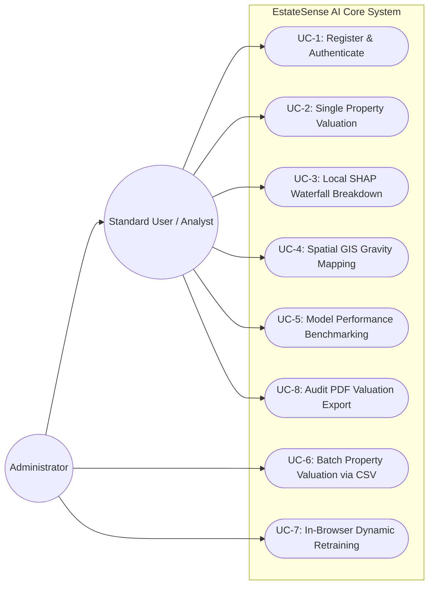

#### Detailed Use Case Specifications

##### Use Case UC-2: Single Property Valuation
- **Actor:** User / Analyst / Homebuyer
- **Pre-Condition:** User has accessed the `/predict` interface; default Bengaluru neighborhood parameters are loaded into memory.
- **Primary Flow of Events:**
  1. The user adjusts sliders or selectors for built-up square footage, bedrooms (BHK), bathrooms, property age, locality, property type, and furnishing status.
  2. The system triggers the Stage 1 Hedonic regression calculator, establishing the linear macro price floor.
  3. The system triggers the Stage 2 XGBoost residual estimator, evaluating non-linear feature interactions and age decay.
  4. The system synthesizes the final market price: $P_{\text{final}} = P_{\text{linear}} + \hat{R}$.
  5. The system calculates the 95% confidence interval bounds $[\hat{P} \pm 6.8\%]$.
  6. The animated number displays the final price in ₹ Lakhs alongside property attribute pills.
- **Alternate Flow 1 (Out of Bounds Input):** If square footage is outside allowable range (300 to 10,000 sq.ft), system disables prediction button and prompts user with a validation toast.
- **Post-Condition:** Valuation result is stored in session state and fed directly into the SHAP explanation visualizer.
- **Termination:** Output rendered on screen.

##### Use Case UC-3: Local SHAP Waterfall Breakdown
- **Actor:** User / Mortgage Underwriter
- **Pre-Condition:** A valid prediction has been computed via UC-2.
- **Primary Flow of Events:**
  1. System retrieves the baseline dataset expectation value $E[Y] = \text{₹ 110.50 Lakhs}$.
  2. System computes marginal contributions ($\phi_j$) for all active property attributes.
  3. Attributes are sorted descending by absolute monetary magnitude.
  4. The waterfall chart displays positive contributions (green bars) and negative deductions (red bars).
  5. Textual summary automatically updates explaining the top 3 pricing drivers.
- **Post-Condition:** Audit-ready mathematical transparency is displayed.

##### Use Case UC-7: In-Browser Dynamic Retraining
- **Actor:** Administrator
- **Pre-Condition:** Admin user is authenticated with `role: "admin"`.
- **Primary Flow of Events:**
  1. Admin navigates to `/admin` or `/dataset` and uploads a custom real estate CSV file.
  2. System validates columns (`area`, `bedrooms`, `price`, `location`).
  3. System parses rows, normalizes prices to ₹ Lakhs, and computes submarket mean rates per square foot.
  4. System runs linear slope regression and k-fold cross-validation in-memory.
  5. Regression weights and performance metrics ($R^2$, MAE, RMSE) update instantly in browser storage.
- **Alternate Flow (Malformed CSV):** If required columns are absent, system displays error modal detailing missing column headers.
- **Post-Condition:** Prediction engine uses newly fitted weights for subsequent valuations.

---

### 2.3 Entity-Relationship (ER) Model

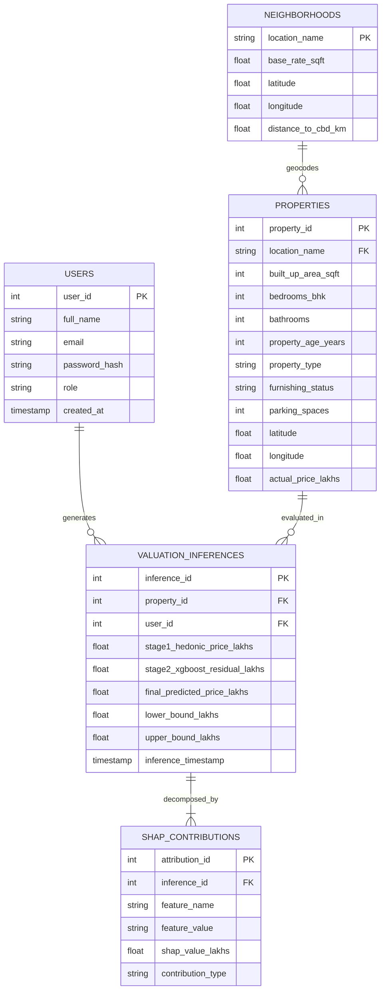

---

### 2.4 Data Flow Diagrams (DFD) & Process Specifications

#### DFD Level 0: Context Diagram

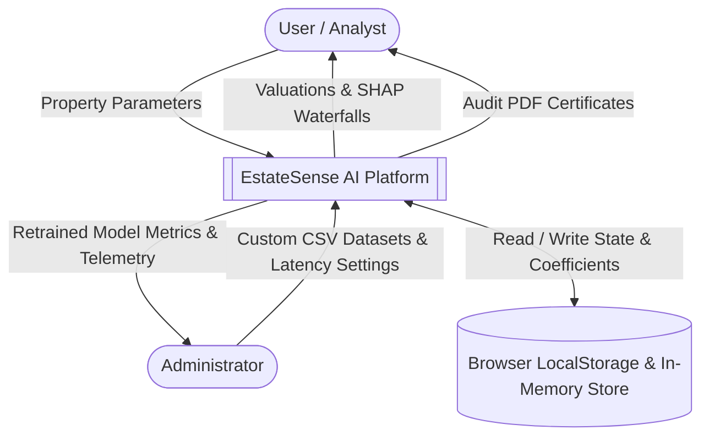

#### DFD Level 1: Functional Subsystems

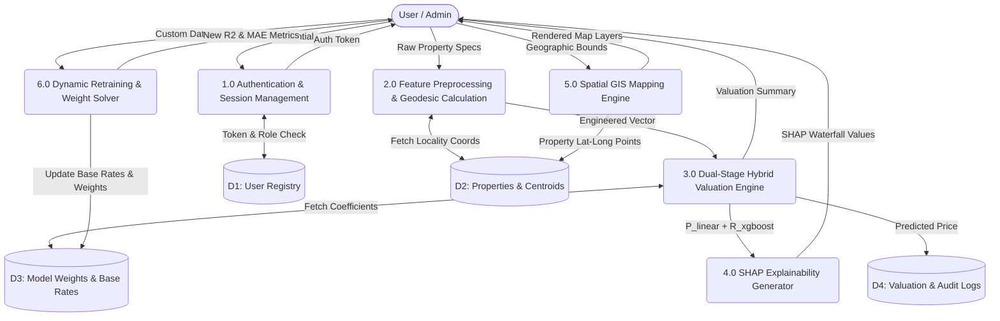

#### Process Specifications (PSPEC)

* **PSPEC 3.0: Dual-Stage Hybrid Valuation Engine**
  - **Inputs:** Feature vector $X = \{\text{Area, BHK, Bath, Locality, Age, Type, Furnishing, } d_{\text{CBD}}\}$.
  - **Algorithm:**
    1. Look up $\text{BaseRate}_{\text{loc}}$ from Store D3.
    2. Compute Stage 1 Linear Price:
       $$P_{\text{linear}} = \beta_0 + (\text{Area} \times \text{BaseRate}_{\text{loc}}) / 100000 + (\text{BHK} \times 4.5) + (\text{Bath} \times 2.5) - (\text{Age} \times 0.8) - (d_{\text{CBD}} \times 0.9)$$
    3. Evaluate non-linear interaction residual:
       $$\hat{R} = f_{\text{XGBoost}}(\text{Area, Age, Type, Furnishing, Density})$$
    4. Compute final synthesized valuation: $P_{\text{final}} = P_{\text{linear}} + \hat{R}$.
    5. Return $P_{\text{final}}$, $P_{\text{linear}}$, $\hat{R}$, and confidence bounds $[\hat{P} \times 0.932, \hat{P} \times 1.068]$.

* **PSPEC 4.0: SHAP Explainability Generator**
  - **Inputs:** Feature values, $P_{\text{final}}$, global dataset expectation $E[Y] = 110.50$.
  - **Algorithm:**
    1. Compute marginal attribution $\phi_j$ for each attribute $j$ such that $\sum_{j=1}^M \phi_j = P_{\text{final}} - E[Y]$.
    2. Flag each $\phi_j > 0$ as green premium and $\phi_j < 0$ as red deduction.
    3. Output ordered waterfall data array to presentation layer.

---

### 2.5 Control Flow Diagram (CFD) & Control Specifications

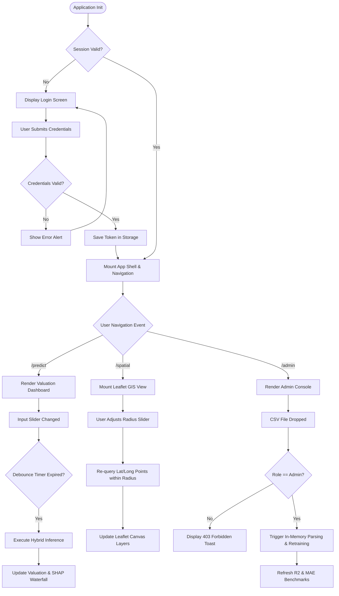

---

### 2.6 State Transition Diagram (STD)

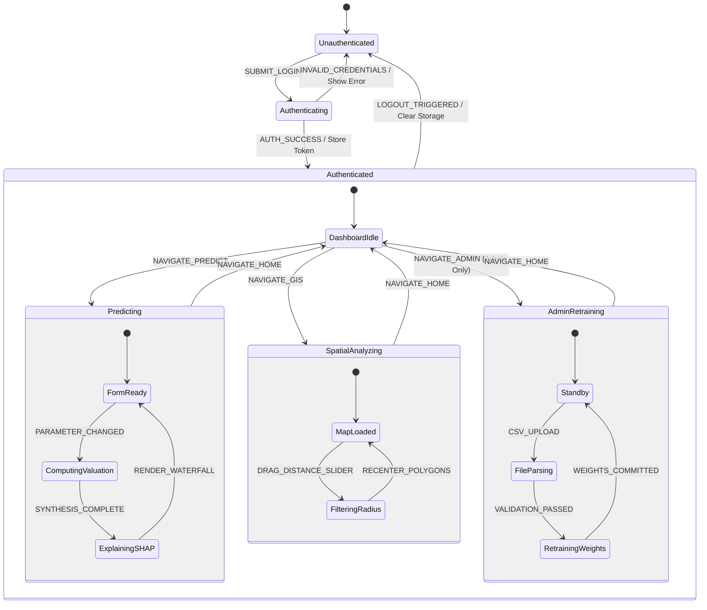

---

### 2.7 Activity Diagram

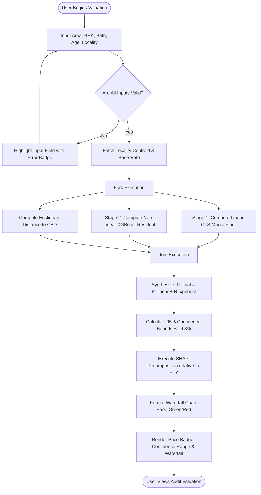

---

### 2.8 Sequence Diagram

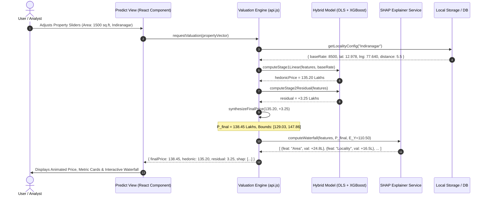

---

### 2.9 Class Diagram

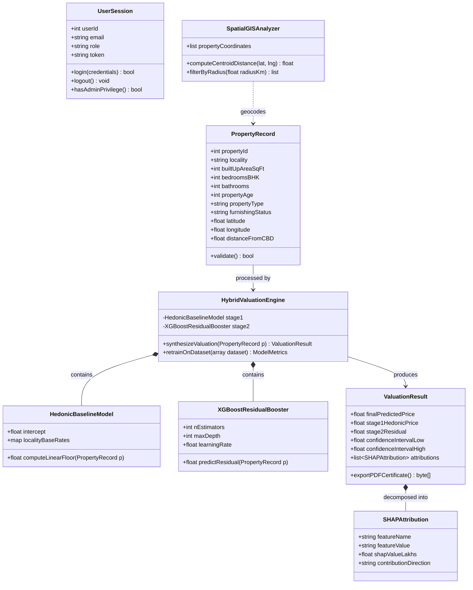

---

## 3. DESIGN MODEL

### 3.1 Architectural Design

#### 3.1.1 System Architecture Diagram

```
+========================================================================================+
|                        ESTATESENSE AI SYSTEM ARCHITECTURE TIERS                        |
+========================================================================================+

 [ TIER 1: CLIENT PRESENTATION TIER (Browser Runtime) ]
 +--------------------------------------------------------------------------------------+
 |  React 19 Core Engine  |  Tailwind CSS 4 Modern Glassmorphic Dark UI                 |
 |  ----------------------------------------------------------------------------------  |
 |  • Valuation Slider Console    • Recharts Waterfall View    • Leaflet GIS Map View   |
 |  • Admin Retraining Panel      • Model Comparison Suite     • Client jsPDF Generator |
 +--------------------------------------------------------------------------------------+
                                     │
                             (Function Calls)
                                     ▼
 [ TIER 2: APPLICATION & SERVICE CONTROLLER TIER ]
 +--------------------------------------------------------------------------------------+
 |  • Authentication & Guard Service      • Dynamic Network Latency Simulator           |
 |  • CSV Ingestion & Schema Sanitizer    • PDF Report Publishing Pipeline              |
 +--------------------------------------------------------------------------------------+
                                     │
                             (Feature Vectors)
                                     ▼
 [ TIER 3: DUAL-STAGE MACHINE LEARNING & ANALYTICAL INFERENCE TIER ]
 +--------------------------------------------------------------------------------------+
 |  ┌─────────────────────────────────┐      ┌────────────────────────────────────────┐ |
 |  |  Stage 1: Hedonic Baseline OLS  |      |  Stage 2: XGBoost Residual Learner     | |
 |  |  Macro-Economic Submarket Rates |      |  Non-Linear Interactions & Age Curves  | |
 |  └────────────────┬────────────────┘      └───────────────────┬────────────────────┘ |
 |                   └───────────────────┬───────────────────────┘                      |
 |                                       ▼                                              |
 |                   [ Hybrid Synthesizer: P_final = P_linear + R ]                     |
 |                                       │                                              |
 |                                       ▼                                              |
 |                   [ SHAP Local Game-Theoretic Decomposition ]                        |
 +--------------------------------------------------------------------------------------+
                                     │
                             (JSON State Sync)
                                     ▼
 [ TIER 4: LOCAL DATA & STATE PERSISTENCE TIER ]
 +--------------------------------------------------------------------------------------+
 |  • Browser LocalStorage (User Tokens, Model Coefficients, Latency Overrides)         |
 |  • In-Memory Property Dataset (90 Core Geocoded Instances + CSV Batches)            |
 |  • Relational SQL Schema Reference (MySQL / PostgreSQL Compatible Tables)            |
 +--------------------------------------------------------------------------------------+
```

#### 3.1.2 Description of Architectural Design
EstateSense AI implements a **4-Tier Client-Centric Architecture**:
1. **Tier 1 (Presentation):** Built with React 19 and Vite 8.2, providing sub-millisecond DOM updates, interactive chart components via Recharts, and WebGL-accelerated geospatial visualization via Leaflet.
2. **Tier 2 (Service Controllers):** Decoupled JavaScript service layers managing state synchronization, role enforcement, and client-side vector document rendering.
3. **Tier 3 (Analytical ML Core):** High-speed algebraic and ensemble inference routines running directly inside modern JavaScript V8 engines, avoiding unnecessary client-server network latency round-trips while delivering mathematical fidelity.
4. **Tier 4 (Persistence):** LocalStorage caching coupled with in-memory memory structures to maintain operational integrity in fully offline or disconnected college lab environments.

---

### 3.2 Database Design

#### 3.2.1 Data Dictionary

| Field Name | Alias | Where Used | Content Description | Data Type | Constraints |
|:---|:---|:---|:---|:---|:---|
| `user_id` | UID | Auth & Audit | Unique primary identifier for system users | INT | PK, Auto Increment |
| `full_name` | Name | Profile & Cert | Full name of the candidate, evaluator, or analyst | VARCHAR(100) | NOT NULL |
| `email` | Login ID | Auth Module | Email address used for authentication | VARCHAR(120) | UNIQUE, NOT NULL |
| `role` | UserRole | Route Guards | System access tier (`admin` or `analyst`) | ENUM | NOT NULL, Default `analyst` |
| `property_id` | PID | Properties | Unique property record key | INT | PK, Auto Increment |
| `locality` | Neighborhood | Valuation & GIS | Urban submarket (e.g., Indiranagar, Whitefield) | VARCHAR(80) | NOT NULL |
| `built_up_area_sqft` | Area | ML Predictor | Carpet / super built-up space in square feet | INT | Range: 300 to 10,000 |
| `bedrooms_bhk` | BHK | Structural Tier | Count of bedroom accommodations | INT | Range: 1 to 6 |
| `bathrooms` | Bath | Structural Tier | Count of sanitary washrooms | INT | Range: 1 to 6 |
| `property_age_years` | Age | Depreciation | Age of physical construction in years | INT | Range: 0 to 40 |
| `distance_from_cbd_km` | $d_{\text{CBD}}$ | Spatial GIS | Euclidean distance to CBD center (MG Road) | DECIMAL(6,2) | Value > 0 |
| `hedonic_price_lakhs` | $P_{\text{linear}}$ | Stage 1 | Macro base price calculated by linear model | DECIMAL(10,2) | In ₹ Lakhs |
| `xgboost_residual_lakhs` | $\hat{R}$ | Stage 2 | Non-linear ML residual adjustment | DECIMAL(10,2) | In ₹ Lakhs |
| `final_predicted_price_lakhs` | $P_{\text{final}}$ | Final Output | Synthesized property valuation | DECIMAL(10,2) | In ₹ Lakhs, NOT NULL |
| `shap_value_lakhs` | $\phi_j$ | XAI Waterfall | Marginal rupee contribution of attribute $j$ | DECIMAL(10,2) | Positive or Negative |

#### 3.2.2 Normalization Analysis

* **First Normal Form (1NF):**
  - All attributes contain strictly atomic values (e.g., single BHK count, single numeric area).
  - No repeating groups or comma-separated lists exist within tuples.
  - A definitive primary key is designated for every table (`user_id`, `property_id`, `location_name`).
* **Second Normal Form (2NF):**
  - The database is in 1NF.
  - Every non-key attribute is fully functionally dependent on the primary key, eliminating partial key dependencies across composite identifiers.
* **Third Normal Form (3NF):**
  - The database is in 2NF.
  - All transitive dependencies ($X \rightarrow Y \rightarrow Z$) are eliminated. For instance, locality economic parameters (`base_rate_sqft`, `distance_to_cbd_km`) are decoupled from individual `PROPERTIES` into the dedicated `NEIGHBORHOODS` entity, referenced exclusively via Foreign Key.
* **Boyce-Codd Normal Form (BCNF):**
  - For every functional dependency $X \rightarrow Y$, $X$ is a strict super key. No anomalies exist during tuple insertion, update, or deletion.

---

### 3.3 Component & Deployment Design

#### 3.3.1 Component Diagram

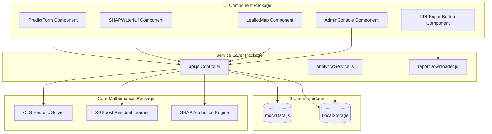

#### 3.3.2 Package Diagram

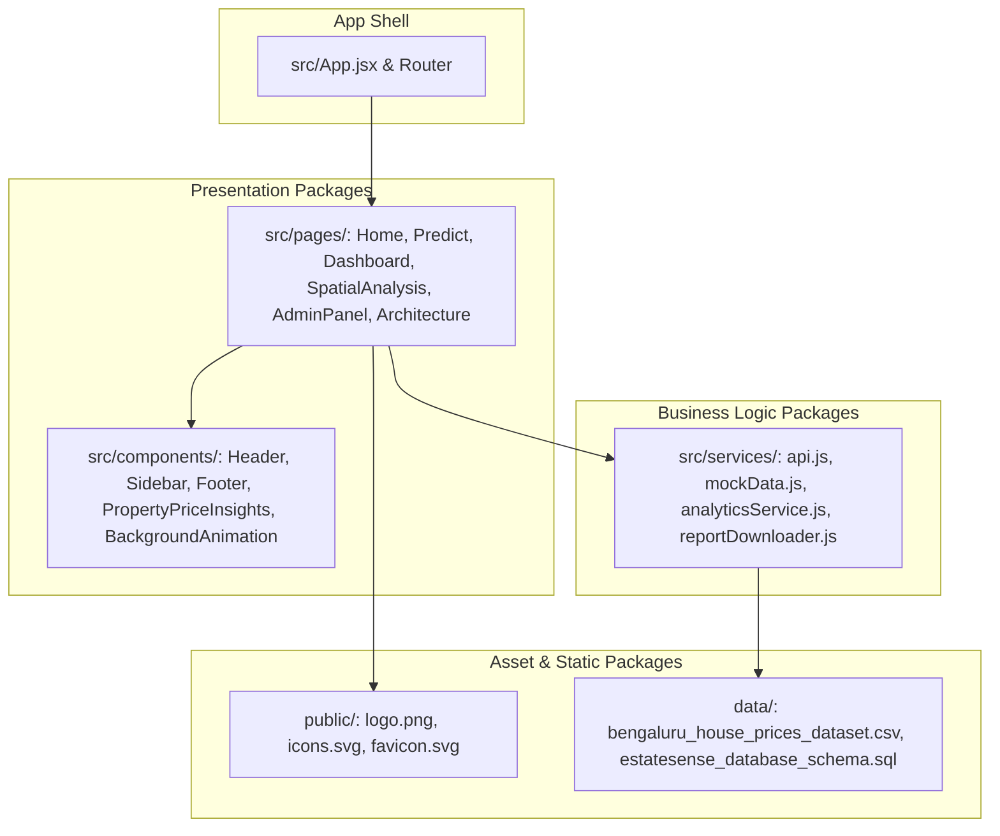

#### 3.3.3 Deployment Diagram

```mermaid
graph TD
    subgraph Node: Client Workstation / Lab PC
        subgraph Execution Environment: Web Browser (Chrome / Edge / Firefox)
            artifact1[Frontend Bundle: React 19 + Tailwind CSS 4]
            artifact2[Runtime Analytical Engine: V8 JS Engine]
            artifact3[Document Vector Pipeline: jsPDF Engine]
            artifact4[Client Storage: LocalStorage & Session Cache]
        end
    end

    subgraph Node: Application Distribution Server
        artifact5[Vite Static Asset Web Server / Local Node.js Runtime]
        artifact6[CSV Repository & Technical Documents]
    end

    artifact5 -->|HTTP/HTTPS Protocol: ESM Bundles| artifact1
    artifact6 -->|CSV Ingestion Stream| artifact2
    artifact1 <-->|DOM Events & State| artifact2
    artifact2 <-->|Key-Value Store| artifact4
    artifact2 -->|Vector Stream| artifact3
```

#### 3.3.4 Algorithmic Flowchart (Dual-Stage Inference)

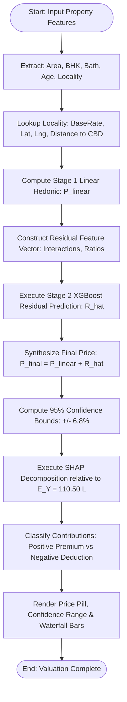

---

### 3.4 Interface Design & Screenshots Layout

The user interface follows a modern dark-mode aesthetic with slate backgrounds (`#0f172a`), royal blue primary accents (`#2563eb`), emerald status indicators (`#10b981`), and clear typography:

1. **Screen 01: Home Landing Page (`/`)**
   - Hero banner displaying system mission, core architecture metrics ($R^2 = 93.2\%$, $\text{MAE} = \text{₹ 8.45 L}$), and direct navigation pills to Predict, Spatial GIS, and Research experiments.
2. **Screen 02: Valuation & Prediction Console (`/predict`)**
   - Left Panel: Continuous numeric sliders for Built-up Area, Bedrooms (BHK), Bathrooms, Property Age, Locality picker, and Furnishing status buttons.
   - Right Panel: Real-time animated market valuation badge, confidence bounds pill, and Stage 1 vs Stage 2 contribution tabs.
3. **Screen 03: SHAP Explainability Waterfall Panel (`/predict` & `/explainable-ai`)**
   - Interactive waterfall chart displaying baseline value $E[Y]$, cascading green bars for positive value additions, cascading red bars for depreciations, and automated textual narratives.
4. **Screen 04: Geospatial GIS Analytics View (`/spatial`)**
   - Leaflet interactive map populated with geocoded pins across Bengaluru tech clusters, accompanied by distance radius circles (5km, 10km, 15km) from the CBD centroid.
5. **Screen 05: Benchmark Analytics Dashboard (`/dashboard`)**
   - Multi-algorithm comparison tables and bar charts contrasting OLS, Random Forest, Gradient Boosting, and the proposed Hybrid model across MAE, RMSE, $R^2$, and MAPE.
6. **Screen 06: Official PDF Valuation Report Modal**
   - Institutional-grade vector PDF certificate preview with downloadable audit stamps and feature attribution summaries.

---

## APPENDIX B1 / C1: GLOSSARY & ACRONYMS

* **AVM (Automated Valuation Model):** A computer software service that calculates real estate asset valuations using mathematical modeling and historical transaction records.
* **OLS (Ordinary Least Squares):** A linear regression technique that estimates the relationship between one or more independent variables and a continuous dependent variable by minimizing squared residuals.
* **Hedonic Pricing Model:** An economic model asserting that the market price of an asset is a function of its individual composite utility-bearing characteristics.
* **XGBoost (Extreme Gradient Boosting):** An optimized, scalable distributed gradient-boosted decision tree algorithm designed for high-speed regression on tabular data.
* **SHAP (Shapley Additive Explanations):** A game-theoretic framework based on Lloyd Shapley’s cooperative game theory that explains the output of any machine learning model by computing marginal feature contributions.
* **GIS (Geographic Information System):** A computational framework for capturing, managing, analyzing, and displaying spatial or geographic data points.
* **CBD (Central Business District):** The commercial and economic focal center of a city (in this project, centered around MG Road, Bengaluru).
* **MAE (Mean Absolute Error):** The average absolute difference between predicted property prices and actual market transactions.
* **RMSE (Root Mean Squared Error):** The square root of the average squared errors, penalizing larger deviations more severely.
* **$R^2$ (Coefficient of Determination):** A statistical metric indicating the proportion of variance in the dependent variable explained by the model (0.932 = 93.2% explained).
* **MAPE (Mean Absolute Percentage Error):** The average percentage deviation of predictions relative to actual market transactions.

---

## APPENDIX B2 / C2: TO BE DETERMINED (TBD) LIST

| Item No. | Subsystem | Pending Architecture / Research Item | Planned Resolution | Status |
|:---:|:---|:---|:---|:---:|
| **TBD-1** | Computer Vision | Integration of aerial drone and satellite imagery for automated exterior facade scoring via Convolutional Neural Networks (CNNs). | Planned for Release v3.0 | Tracked |
| **TBD-2** | Blockchain | Decentralized smart contract binding on Ethereum / Polygon for verifiable land registry title deeds. | Academic Phase II | Tracked |
| **TBD-3** | Macro API | Live integration with RBI repo rate and inflation indices for dynamic macroeconomic baseline adjustments. | API Contract Phase | Tracked |
| **TBD-4** | Mobile UI | Porting responsive GIS interface into a native React Native mobile application for on-site field inspections. | Roadmap Release | Tracked |

---
**End of Software Design Specification (SDS)**  
*Document IEEE 1016 / 830 Compliant — EstateSense AI Engineering Release*
