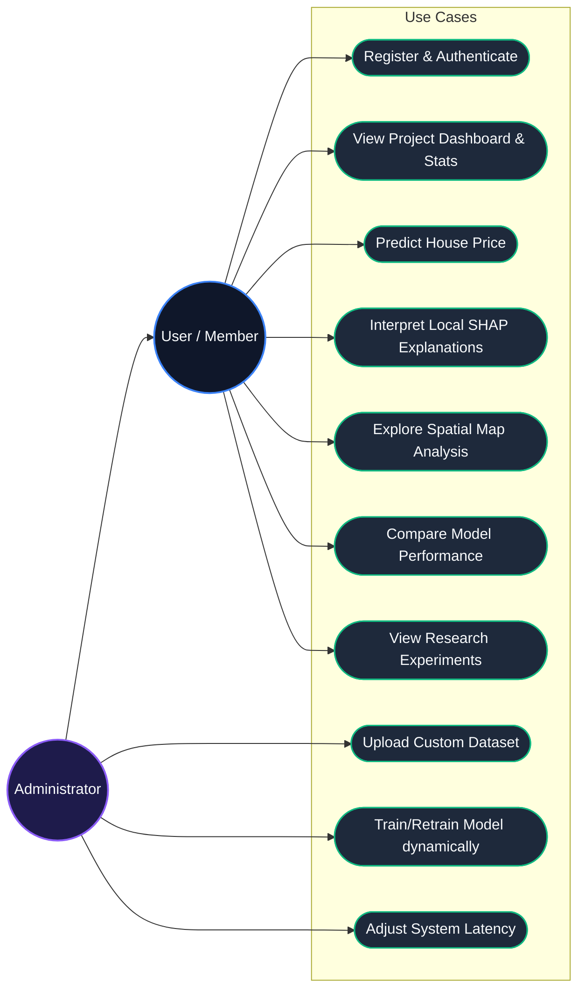
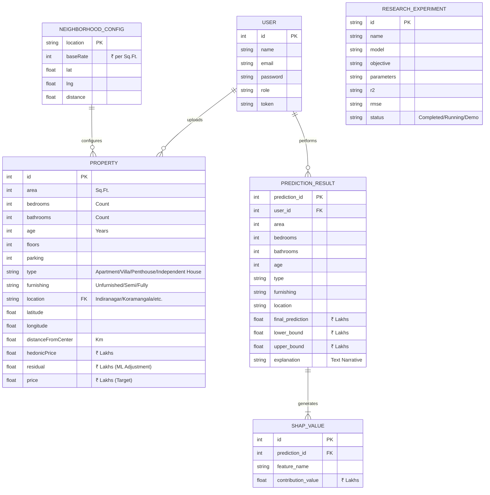
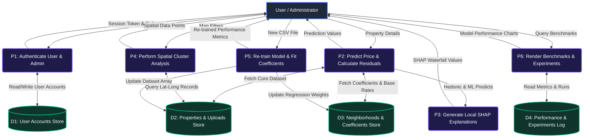
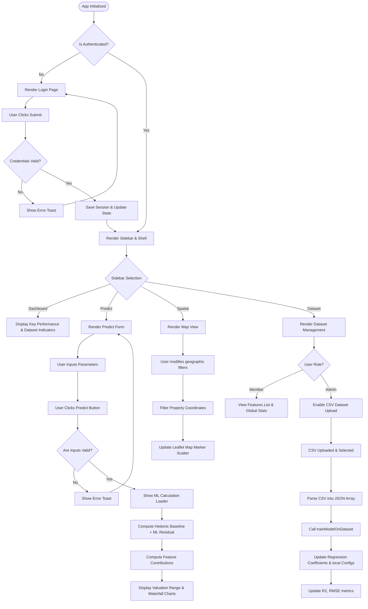
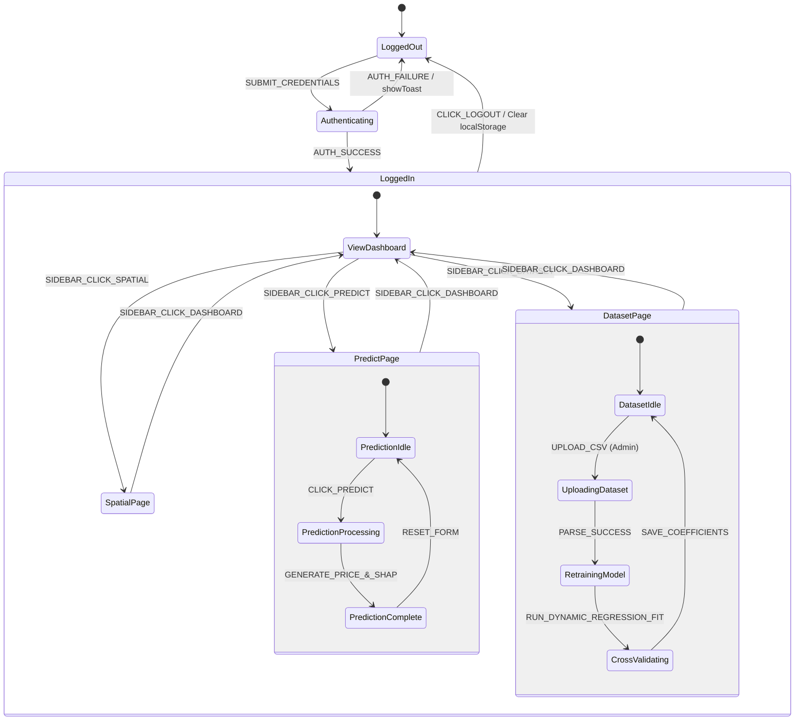

# House Price Prediction System - System Design Diagrams

This report provides the system architecture, flow, data structures, and state transitions for the **House Price Prediction System with Explainable AI (SHAP)**. The diagrams are represented using **Mermaid.js** format, which can be viewed directly in markdown viewers or copied into report documentation.

---

## 1. Use Case Diagram

The **Use Case Diagram** illustrates the interactions between the system's actors (the standard **User/Member** and the **Administrator**) and the various functionalities (use cases) provided by the application.

### Description of Use Cases:
* **Register & Authenticate:** Users can create an account and log in. An administrator has special elevated roles.
* **View Project Dashboard:** Displays general information, performance curves, global feature importance charts, and key stats.
* **Predict House Price:** Input area, bedrooms, bathrooms, location, age, parking, type, and furnishing state to calculate expected valuations.
* **Interpret Local SHAP Explanations:** Explains *why* the prediction was made, breaking down the exact pricing contribution (positive or negative) of each feature.
* **Explore Spatial Map Analysis:** Inspects geographically plotted properties on the city map (e.g., Bengaluru coordinates) and filters them.
* **Compare Model Performance:** Views metrics (MAE, RMSE, $R^2$, MAPE) of baseline vs. ML models.
* **Upload Custom Dataset (Admin):** Allows uploading of custom property CSV files to fit the prediction model.
* **Train/Retrain Model (Admin):** Dynamically runs Linear Regression slope calculations and KNN calculations to recalculate weights, biases, coefficients, and metrics on-the-fly.

---

## 2. Entity-Relationship Model (ER Model)

The **ER Model** defines the schema structures and relationships of the logical entities managed in localStorage and runtime states.

### Entity Metadata:
* **USER:** Handles authentication and role-based privileges (`Administrator` vs. `Member`).
* **PROPERTY:** Represents instances of real estate properties, capturing physical dimensions, geographic features, baseline calculations, and final prices.
* **NEIGHBORHOOD_CONFIG:** Stores baseline parameters for location-based valuation (coordinate centers and base price per square foot).
* **PREDICTION_RESULT & SHAP_VALUE:** Stores the transaction inputs along with the generated regression/boosting components, ranges, and individual feature SHAP impact values.

---

## 3. Data Flow Diagram (DFD) - Level 1

The DFD shows how information moves from external sources (User and Admin) through processes, gets read/written to stores, and renders back to the user.

### Data Flow Descriptions:
* **P1 (Authentication):** Validates logging credentials against the local storage user record.
* **P2 (Predictor Engine):** Uses regression baselines ($BasePrice = Area \times BaseRate$) adjusted by categorical bonuses and an XGBoost/KNN-based residual helper to produce final predictions.
* **P3 (SHAP Calculator):** Distributes the prediction variance relative to the dataset base rate across features to formulate explanations.
* **P5 (Model Training Process):** Dynamically calculates covariances and slopes (e.g., area-to-price ratio) whenever a custom dataset is uploaded, overwriting baseline coefficients.

---

## 4. Control Flow Diagram (CFD)

The **Control Flow Diagram** charts decisions, function routing, and visual conditional renderings across different views.

---

## 5. State Transition Diagram (STD)

The **State Transition Diagram** outlines how pages and processing cycles transition in response to user inputs and lifecycle hooks.

